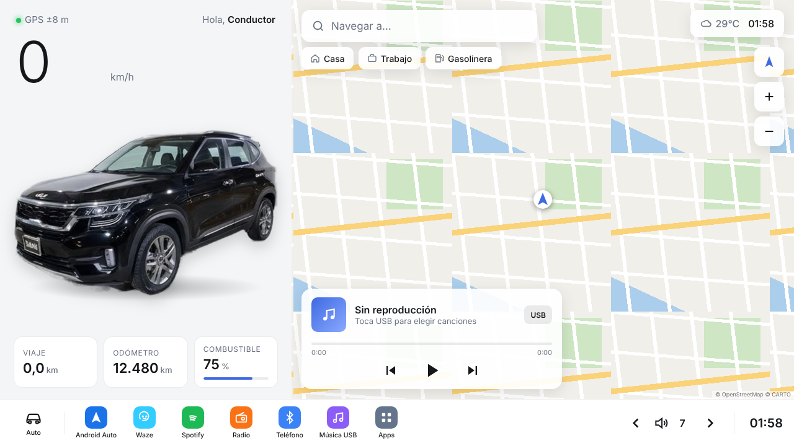
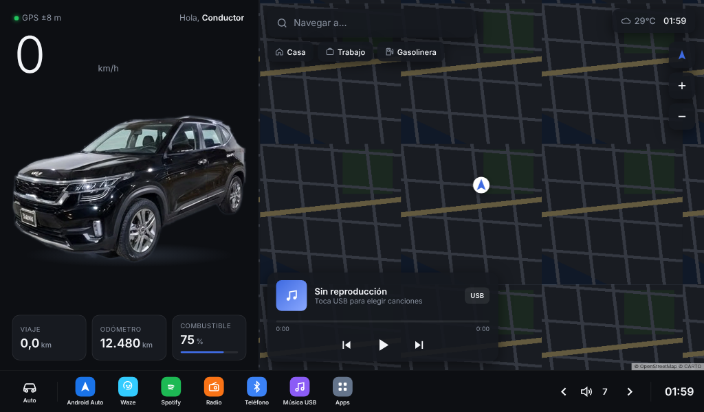

# Seltos Launcher: pantalla de inicio estilo Tesla para el Kia Seltos

Launcher para radios **Android de reemplazo** (9"/10", 1024×600, 1280×720 o similar). Es **un solo archivo** (`index.html`) que funciona sin internet; el mapa y el clima necesitan conexión.

| Día | Noche (1024×600) |
|---|---|
|  |  |

## Funciones
- **Panel del auto:** foto real del Seltos negro, velocidad y rumbo con **GPS**, contador de viaje medido con GPS, odómetro (suma los km recorridos) y combustible (manual).
- **Mapa en vivo** (OpenStreetMap + CARTO) con tu posición, seguimiento y zoom.
- **Navegar a…:** escribe un destino o usa *Casa*, *Trabajo* o *Gasolinera*; abre la ruta en **Waze**.
- **Música USB:** elige canciones de la memoria o el USB y se reproducen con barra de avance y volumen. Los botones del volante pueden funcionar si el radio lo soporta (Media Session).
- **Clima real** (Open-Meteo), con **tema claro/oscuro automático** según la salida y puesta del sol.
- **Dock de apps:** Android Auto, Waze, Spotify, Radio, Teléfono, Música USB y Apps.
- **Ajustes:** nombre, tema, color de acento, odómetro, combustible, direcciones de Casa y Trabajo, reiniciar viaje.
- Mantiene la pantalla encendida y se adapta a cualquier resolución sin franjas negras.

## Seguridad
Es una página web dentro de un navegador: **no se conecta con la computadora del auto** (motor, frenos, CAN bus) ni modifica el sistema del radio. Para quitarla, vuelve a elegir el inicio original en Android.

## Instalación en el radio
1. Copia `index.html` al radio (por ejemplo, a `Download/`).
2. Instala **Fully Kiosk Browser** y pon como *Start URL* `file:///sdcard/Download/index.html`.
3. Activa en Fully Kiosk: pantalla completa, permiso de **ubicación** y "usar como Launcher".
4. En Android, elige Fully Kiosk como app de inicio.

## Para desarrolladores
- El código fuente está en `src/index.src.html`. Genera el archivo final con `python3 src/build.py`, que incluye Leaflet 1.9.4 y la foto dentro del HTML.
- Compatible con WebView/Chrome 84 o posterior.
