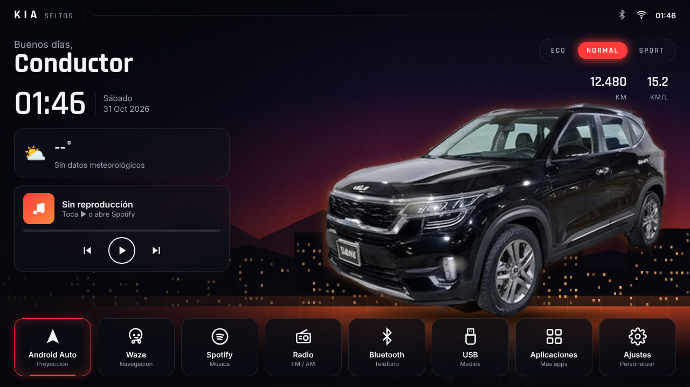

# Seltos Launcher — interfaz para radio Android del Kia Seltos

Pantalla de inicio personalizada (HTML, un solo archivo) pensada para radios Android de 9"/10" (1024×600, 1280×720 o similar).

## Qué incluye
- Saludo según la hora + tu nombre, reloj grande y fecha en español.
- Foto real del Kia Seltos negro (fondo removido, embebida en el HTML: sigue siendo un solo archivo).
- Clima en vivo (Open-Meteo, sin API key) usando el GPS del radio.
- Tarjeta de música con controles.
- Selector de modo de manejo ECO / NORMAL / SPORT con consumo estimado.
- Kilometraje editable.
- Dock con accesos: Android Auto, Waze, Spotify, Radio, Bluetooth, USB, Aplicaciones y Ajustes.
- Panel de ajustes: nombre, 6 colores de acento (rojo, azul, morado, verde, ámbar, plata), modo día/noche.
- Se escala solo a cualquier resolución de pantalla.

## Cómo instalarlo en el radio
1. Copia `index.html` a la memoria del radio (USB o descarga).
2. Instala un navegador en modo kiosco, por ejemplo **Fully Kiosk Browser**.
3. En Fully Kiosk: *Start URL* → `file:///sdcard/Download/index.html`, activa *Launcher* y pantalla completa.
4. En Ajustes de Android, elige Fully Kiosk como app de inicio (Home).
5. Toca **Ajustes** (o tu nombre) para personalizar.

> Los botones del dock usan *intents* de Android; si alguno no abre la app en tu radio, cambia su `href` por el paquete correcto de tu unidad.
